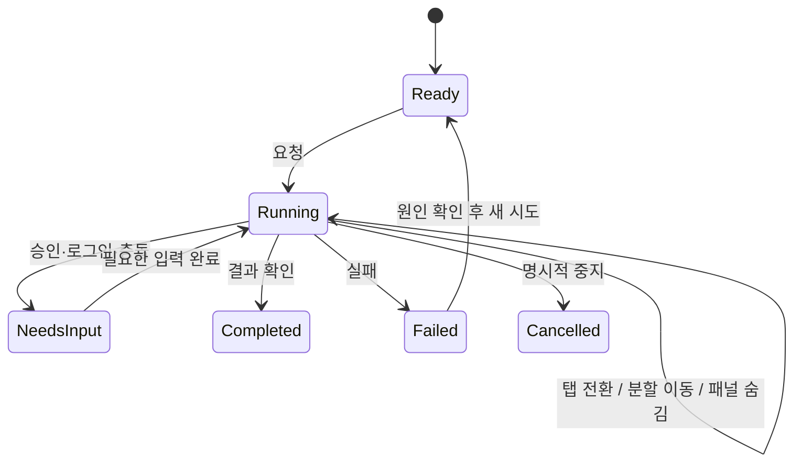

# 흐름과 상태

화면 ID는 [전체 화면 목록](screen-inventory.md)의 S01~S15, 결정 ID는 [결정 기록](decisions.md)의 D01~D14를 따른다.

## 기본 구조

사이드바는 프로젝트/전역 자료의 위치를, 작업 탭은 열어 놓은 대화·문서를, 도구 모음은 현재 선택한 내용에 가능한 행동을 담당한다. 서로 다른 역할을 같은 탭 선택기로 겹치지 않는다. `design-principles/simplicity/establish-hierarchy` `toolbars/actions/provide-actions-that-support-the-main` [HIG transfer]

## 진입과 이동

| 흐름 | 진입 → 행동 → 도착 | 뒤로/닫기/중단 | 연결 |
|---|---|---|---|
| F01 시작·복귀 | 앱 실행 → 마지막 작업 복원, 없으면 S01 | 초기 설정을 건너뛰어 로컬 문서 생성 가능 | D01, D14 |
| F02 프로젝트 | 이름 클릭 → S02 개요; 펼침 클릭 → 내용 목록 | 상위 프로젝트/폴더 경로로 이동 | D01 |
| F03 수동 새 문서 | 상단/프로젝트 메뉴 → 형식·위치 선택 → S04/S05 | 생성 취소 시 원래 탭·선택 유지 | D03 |
| F04 병렬 AI | S03 메인에서 시작 → 문서 탭 S04에서 별도 요청 → 다른 탭으로 이동 | 작업은 유지. `중지`만 해당 작업에 적용 | D06, D07 |
| F05 문서·외부 앱 | S04 편집 → 앱으로 열기 → 외부 저장 → 복귀 | 최신 판 확인; 미저장 충돌은 해당 문서에 표시 | D04, D13 |
| F06 통합 검색 | Ctrl+K/검색 버튼 → S08 → 결과·미리보기 → 원문 위치 | Esc는 검색만 닫고 이전 위치·초점 복원 | D08 |
| F07 볼트 | S07 폴더 → 노트 → 링크 → 뒤로/앞으로/상위 폴더 | 한 칸의 기록만 이동; 다른 칸은 유지 | D01, D09 |
| F08 Bases·그래프 | S02/S07의 보기 선택 → 표/보드/그래프 | 동일 집합·선택·필터 보존 | D01, D12 |
| F09 변경 검토 | S03/S10 결과 → 비교·승인/적용 → 원래 작업 | 닫기로 원래 세션·스크롤 복원 | D10, D13 |
| F10 연결·설정 | S12/S13 → 모델·앱·Dropbox 설정 | 닫으면 원래 문서로 복귀; 설정 변경이 실행 재시작을 유발하지 않음 | D11, D14 |
| F11 웹 작업 | S09 웹 → 이 페이지의 AI → 다른 탭 → 진행/결과 확인 | 보는 것, 제어 인계, 작업 중지 구별 | D05~D07; 별도 웹 엔진 의존 |

`launching/best-practices/restore-the-previous-state-when-your` `design-principles/flexibility/preserve-a-persons-context` [HIG transfer]. 복원할 데이터와 host 동작은 [Engineering] 계약이다.

## 병렬 작업의 사용자 상태

상태 모델은 [Engineering]이다. HIG는 진행을 정확히 알리고 사용자가 제어할 수 있어야 한다는 판단을 제공한다. `progress-indicators/best-practices/be-as-accurate-as-possible-when` `generative-ai/best-practices/keep-people-in-control`

| 상태 | 표시 | 사용자가 할 수 있는 행동 |
|---|---|---|
| 준비 | 작업 대상·모델·입력 | 수동 편집, 요청 |
| 작업 중 | 탭의 아이콘+상태 문구, 대화의 실제 단계 | 다른 작업, 상세 보기, 중지 |
| 입력 필요 | 대상 탭 표시+필요한 이유; 기존 알림 정책 | 해당 탭 열기, 승인/수정/취소 |
| 완료 | 결과물·요약, 한 번의 완료 이벤트 | 열기, 비교, 메인 대화에서 이어가기 |
| 실패 | 무엇이 실패했는지와 남아 있는 결과 | 상태 확인, 가능한 재시도 |
| 중단됨 | 앱 재시작 등으로 실행이 사라졌음을 표시 | 저장 결과 확인 후 재개 |

예상 분모가 없는 AI 작업에 가짜 완료율을 표시하지 않는다. 여러 탭의 상태를 확인하는 UI가 메인 세션을 busy로 만들지 않는다. [House + Engineering]

## 좁은 창과 키보드

창이 좁아지면 보조 패널을 숨기거나 한 번에 하나씩 열되, 선택한 프로젝트·탭·입력 초안을 유지한다. 임의로 다른 탭으로 이동하거나 문서의 AI를 종료하지 않는다. `layout/adaptability/design-a-layout-that-adapts-gracefully` [HIG transfer]

Tab/Shift+Tab, 방향키, Enter, Esc, 컨텍스트 메뉴 키와 기존 단축키를 지원한다. 편집기의 Ctrl+S와 검색 Ctrl+K를 웹 탭용 단축키로 덮어쓰지 않는다. 클릭만 가능한 동작은 대응 메뉴/키보드 경로를 둔다. `keyboards/best-practices/respect-standard-keyboard-shortcuts` `keyboards/best-practices/support-full-keyboard-access-when-possible` [HIG transfer]

## 되돌리기와 삭제

보관/해제처럼 실제 복구 경로가 있는 행동은 해당 경로를 제시한다. 현재 프로젝트 삭제는 앱의 프로젝트·대화를 삭제하고 파일/작업 폴더를 보존하며, 대화 삭제는 되돌릴 수 없다고 안내한다. 새 UI에서도 이 의미와 취소 기본 초점을 유지한다. 존재하지 않는 Undo를 장식으로 제공하지 않는다. [현재 코드 관찰 + House]

`design-principles/agency/help-people-recover-from-mistakes` `alerts/buttons/if-theres-a-destructive-action-include` [HIG transfer]
