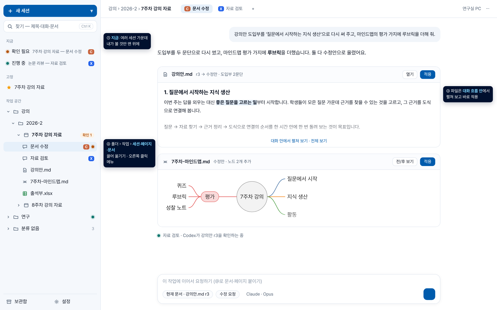
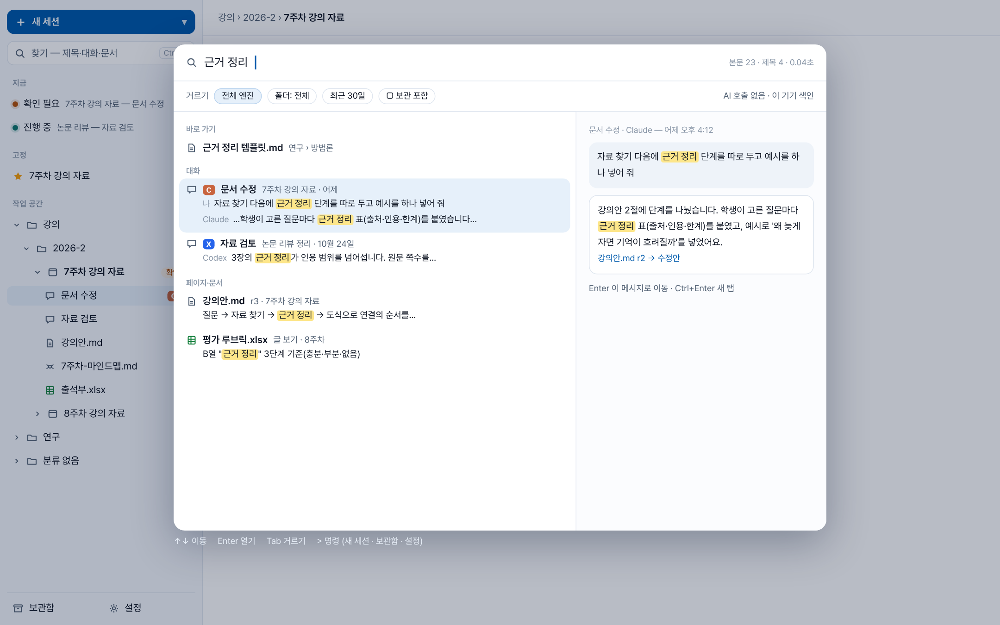
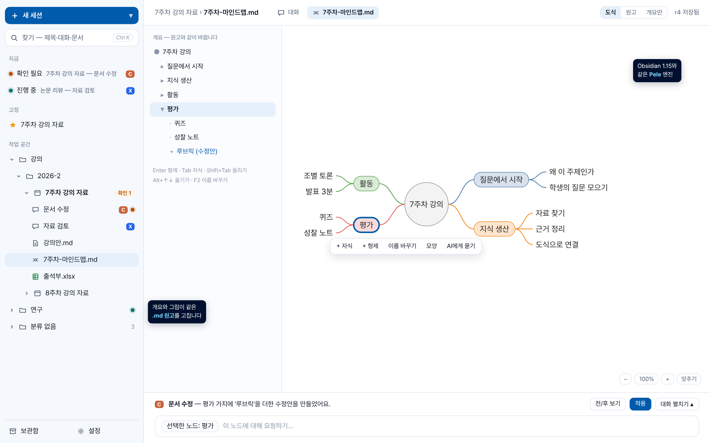

# 다음 계획: 메타 세션·페이지·Pele 도식·이음 마무리

- 작성: 2026-10-28
- 사용자 요청(같은 날 저녁)
  - 여러 세션을 동시에 돌릴 때를 위한 "메타 세션" 화면: 폴더처럼 정리, 보관, 제목·본문 찾기
  - litpage를 결합해 쉬운 사용성, 직관적인 동선, 데이터 위계, 마크다운 호환 흐름
  - 이음오피스 남은 일 마무리
  - 마인드맵을 Pele로 바꾸기
  - Canva 커넥터는 넣지 않는다(doory가 대신한다).
- 근거
  - 현재 코드 분석(`a01d658` 기준)
  - litpage 코드 리뷰(`litmers-dev/litpage` `931cd28`, 읽기만 함)
  - Pele 1.12.0 패키지 확인과 WebKitGTK 실측
  - 이음 vendor `30ff4f0`
  - Achmage 결정·연구 기록

## 한 줄 결론
- **사이드바를 "세션의 집"으로 바꾼다.**
  - 트리는 폴더 › 작업 › 세션·페이지·문서다.
  - 맨 위에 "지금(확인 필요·진행 중)", 아래에 보관함을 둔다.
  - Ctrl+K 하나로 제목과 대화 본문까지 찾는다.
- **litpage는 코드를 들여오지 않는다.** 사이드바·찾기·보관의 쓰임새(UX 패턴)를 우리 데이터 위에 다시 만든다.
- **페이지는 `.md` 파일이다.** 이음 마크다운 편집기(블록 단위 무손실 저장)로 노션처럼 고친다.
- **마인드맵은 Pele로 그린다.** `.md` 안 mermaid mindmap 블록이고, Obsidian 1.15와 같은 엔진이다.
- **이음 마무리는 함께 진행한다.** 매일 막히는 것부터 한다: 그림 넣기, 붙여넣기, PDF, 이음 설치 없이 글 보기.

## 시안 (정적 그림, 실제 동작 아님)
- 시안 1: 새 사이드바와 대화 흐름 안 파일 카드. 마인드맵은 실제 Pele 렌더다.
  
- 시안 2: Ctrl+K 찾기 — 대화 본문·페이지·문서를 한 번에 찾는다.
  
- 시안 3: 마인드맵 도식 보기 — 개요와 Pele 그림이 같은 `.md` 원고를 고친다. 아래는 대화 서랍이다.
  

## 1. 바뀌지 않는 기준
- 순정 Codex에 가깝게 만든다. 계획·파일·편집은 채팅 흐름 안에서 이어진다.
- 기본 화면은 아주 단순하게 둔다(Workflow Engineering, 단계 줄이기). 분할 화면은 전제하지 않는다.
- 폴더 정렬·상태·검색 색인·파일 열기는 AI를 한 번도 부르지 않는다. 의미 검색·요약을 넣으면 쓴 모델과 근거를 보여 준다(R-003).
- 판(revision)·수정안·한 작성자 계약은 그대로 둔다. 사람 볼트 원본은 읽기 전용이다.
- Rust/Tauri 방식을 따른다. 편집기는 웹뷰 안에서, 무거운 일은 Rust(WASM)로 한다. Electron 흉내는 쓰지 않는다.

## 2. 지금 상태 (관찰)
**화면**
- 탐색 화면이 셋이다: 사이드바 트리, "작업 찾기", "한눈에". 같은 일을 세 군데서 한다.
- 사이드바에는 작업만 보인다. 세션은 지금 연 작업 아래에서만 보인다.
- 작업 아이콘이 문서 아이콘과 같아 파일처럼 보인다.
- 다음 기능이 없다: 보관, 고정, 순서 바꾸기, 폴더 이름 바꾸기·옮기기.
- 찾기는 제목과 폴더 이름만 본다. "답 내용"은 마지막 답의 앞 180자뿐이다.
- 문서를 열면 대화가 가려진다. 문서 화면 입력창은 AI 답을 보여 주지 않는다.
- 사이드바는 기본으로 접혀 있다. 오른쪽 클릭은 엔진 외형 메뉴가 쓰고 있다.

**게이트웨이**
- 메시지 본문(사용자 글·답·도구 출력)은 이미 SQLite에 저장한다. 다만 색인은 없다.
- 지우기·보관 경로가 없고 이벤트는 "추가·갱신"만 있다. 스냅샷은 모든 기록을 보내 계속 커진다.
- 세션은 작업 하나에 고정된다(엔진이 작업 디렉터리에서 돈다).
- 지금 보는 세션을 서버에 저장한다. 그래서 탭을 누르면 작업의 최근 시각이 바뀌고 목록이 움직인다.
- 접힘·최근·안 읽음·열린 탭이 브라우저 저장소에 있어 PC와 모바일이 나눠 쓰지 못한다.
- 동시 실행에 한도가 없다. Claude 세션 하나가 약 250~340MB이고, OS 알림·트레이도 없다.

**확인한 가능성**
- Node 내장 SQLite의 FTS5 trigram은 한국어 3자 이상을 찾는다.
- 1~2자(예: "근거")는 LIKE로 보충해야 한다. litpage도 같은 방식이다.

## 3. 바꾸는 결정 (기록할 반전)
- **사이드바 기본 접힘 → 데스크톱에서 기본 펼침**(접을 수 있음).
  - 이전 근거: PRD §2.1, 단일화면 v2, 통합설계 v5, 시안 검토의 "상시 좌우 패널 없음".
  - 이유
    - 사용자 기준인 순정 Codex는 왼쪽에서 세션을 보관·탐색한다(2026-10-16 결정).
    - 이번 요청은 여러 세션을 함께 굴리는 것이다.
    - 접힌 입구로는 진행 중·확인 필요를 계속 볼 수 없다.
- **"작업 찾기"와 "한눈에"는 없앤다.** 사이드바와 Ctrl+K 찾기로 합친다.
- **유지하는 것**
  - 앱을 열면 마지막 작업을 다시 연다(v2).
  - 새 세션은 사이드바 맨 위 버튼이나 Ctrl+N 한 번으로 연다. 폴더를 고르지 않으면 "분류 없음"으로 간다.

## 4. 메타 세션 설계

### 4.1 데이터 위계 — 폴더는 앱 안 분류, 내용은 마크다운
```
폴더 (중첩, 앱 안 분류 — 디스크와 분리)
 └ 작업 (디렉터리 하나 = 프로젝트)
     ├ 세션   Claude·Codex 대화, 작업 디렉터리에 묶임
     ├ 페이지 .md 파일 (작업 디렉터리 안)
     └ 문서   docx·pptx·xlsx·hwpx·pdf… (판 기록)
보관함 (숨김, 찾기에서 "보관 포함"으로, 복원 가능)
```
- **폴더는 디스크와 분리한다(v5 유지).**
  - Claude 세션 재개는 작업 디렉터리 경로에 묶여 있다.
  - 폴더를 옮길 때 디렉터리까지 옮기면 재개가 깨진다.
- **마크다운 호환은 "내용"으로 지킨다.**
  - 페이지는 `.md` 파일이다.
  - 세션 기록은 `.workbench/sessions/<날짜>-<제목>.md`로 저절로 내보낸다(AI 0회, 사용자 글과 답만).
  - 그래서 Obsidian·grep·다른 AI 세션이 그대로 읽는다.
- **볼트 연결은 선택이다.** 작업 디렉터리를 Obsidian 볼트 안에 두면 볼트에서도 보인다. 그때도 사람 원본은 수정안으로만 고친다.
- **옮기기**: 세션은 작업에서 옮기지 않는다. 작업과 폴더는 옮긴다.
- **보는 상태**
  - "지금 보는 세션"은 창(클라이언트)마다 따로 둔다. 서버에는 "마지막으로 본 것"만 남긴다. 눌렀다고 목록이 움직이지 않는다.
  - 접힘·고정·순서·최근·안 읽음은 게이트웨이에 둔다. PC·모바일이 같은 것을 본다(v5 요구).

### 4.2 사이드바
```
[ + 새 세션 ▾ ]                    [ 찾기  Ctrl+K ]
지금 (없으면 숨김)
  ● 확인 필요   7주차 강의 자료 — 문서 수정 · Claude
  ◐ 진행 중     논문 리뷰 — 자료 검토 · Codex
고정
  ★ 7주차 강의 자료
작업 공간
  ▾ 강의 › 2026-2
    ▾ 7주차 강의 자료                    ◐
        💬 문서 수정 · Claude              ●
        💬 자료 검토 · Codex
        📝 강의안.md
        📄 출석부.xlsx
    ▸ 8주차
  ▸ 연구
  ▸ 분류 없음
──────────
보관함 · 설정
```
- **줄 모양**
  - 세션: 말풍선, 엔진 표시, 상태 점(진행·확인 필요·안 읽음·오류)
  - 작업: 프로젝트 모양(문서와 구분)
  - 페이지·문서: 파일 모양
- **작업에 세션이 하나뿐이면** 작업 줄 하나로 보인다. 누르면 그 세션이 열린다.
- **끌어 옮기기**: litpage처럼 줄 높이를 위 25%·가운데 50%·아래 25%로 나눠 "앞에·안으로·뒤에"를 정한다.
  - 키보드로도 옮긴다(Alt+↑↓, Alt+→ 안으로). litpage는 마우스로만 옮긴다.
- **오른쪽 클릭은 트리 메뉴다**: 이름 바꾸기, 고정, 보관, 옮기기, 이 작업에 새 세션, 새 페이지.
  - 엔진 외형 메뉴는 세션 머리의 "⋯"로 옮긴다.
- **정렬**: 직접(끌어 놓은 순서)·최근 활동·이름 중에서 고른다. 기본은 직접 정렬과 "지금" 칸이다.
- **색**: 엔진 외형은 대화 면에만 입힌다. 사이드바는 중립색으로 두어 선택할 때마다 바뀌지 않게 한다.
- **너비**: 끌어서 240~480px로 바꾸고 기억한다. 좁은 창·모바일에서는 서랍으로 연다.

### 4.3 찾기 (Ctrl+K)
- **창 하나가 세 가지를 한다**
  - 바로 가기: 작업·세션·페이지 제목
  - 본문 찾기: 대화, 페이지, 문서 글 보기
  - 명령: 새 세션, 보관함 열기 등
- **게이트웨이 색인**: SQLite FTS5 trigram에 1~2자 LIKE 보충.
  - 색인하는 것: 사용자 글과 AI 답(도구 출력·추론은 뺌), 페이지 `.md`, 캐시된 문서 글 보기
  - 턴이 끝날 때 색인한다. 흘러나오는 중간 글은 색인하지 않는다.
- **결과**
  - 세션별로 묶고, 일치한 문장을 강조해 미리 보여 준다.
  - 열면 그 메시지로 스크롤해 강조한다.
  - 필터: 엔진, 폴더, 기간, 보관 포함(litpage Quick Find처럼)
- AI 0회다. 나중에 의미 찾기를 넣으면 쓴 모델과 근거를 함께 보인다.

### 4.4 보관·지우기
- **보관**: 세션·작업·폴더를 숨긴다.
  - 폴더를 보관하면 안의 것도 함께 숨는다(litpage처럼 상속).
  - 보관함에서 한 번에 되돌린다.
- **진행 중인 세션**은 메뉴가 "멈추고 보관"으로 바뀐다. 보관과 실행 중지를 섞지 않는다(v5).
- **엔진 쪽 기록**: Codex는 엔진의 thread 보관도 맞춘다. Claude는 Workbench 표시만 바꾼다.
- **영구 지우기**(휴지통, 30일 뒤 비움)는 다음 단계다. 판·세션 기록·엔진 쪽 기록을 어떻게 지울지 먼저 정한다.
- **스냅샷**은 보관하지 않은 것만 보낸다. 오래 써도 처음 여는 속도가 같다. 지우기·보관 이벤트를 새로 둔다.

### 4.5 여러 세션 함께 굴리기
- **세션 상태를 하나로 맞춘다**: 대기, 진행, 확인 필요, 끝남(안 읽음), 오류, 멈춤.
- **알림**
  - 사이드바 "지금" 칸이 기본이다.
  - 창이 뒤에 있으면 OS 알림을 띄운다(Tauri notification).
  - 창을 닫아도 진행되게 트레이에 남긴다(단계 C 항목을 여기서 함께).
- **메모리 안내**: 동시 진행이 4개를 넘으면 사이드바에 메모리 사용을 알린다. 막지는 않는다.
- **이벤트 재생 한계(5000개)**: 끊겼다 다시 붙으면 세션 단위로 다시 받는다.

### 4.6 문서를 연 채로 대화 잇기 (처음 의도)
- **가벼운 형식**(md·이미지·PDF·도식)은 대화 흐름 안 카드에서 바로 펼쳐 본다(높이 제한, 펼치기).
- **무거운 형식**(워드·PPT·엑셀·한글)은 가운데 면에서 연다.
  - 아래 "대화 서랍"에 최근 답과 진행 상태를 늘 보인다.
  - 펼치면 대화 전체가 겹쳐 열린다. 분할 화면이 아니다.
- 문서 화면 입력창에서 보낸 요청의 답이 서랍에 바로 보인다.

### 4.7 페이지 — 노션처럼 고치되 파일은 `.md`
- **"새 페이지"**는 작업 디렉터리에 `<제목>.md`를 만들고 바로 연다.
- **편집기는 이음 마크다운 편집기(`apps/markdown`)다.**
  - TipTap으로 평범한 `.md`를 고친다.
  - 바뀐 블록만 다시 쓰는 무손실 저장이라 git diff가 작다.
  - 프런트매터·줄바꿈·BOM을 보존한다.
  - 위키링크 `[[대상|별칭#제목^블록]]`, 각주, 수식, 슬래시 명령, 블록 끌기를 지원한다.
  - 워드와 같은 방식으로 붙인다: 원본 무수정, 편집기 출처, 판 규칙.
- **mermaid 블록은 Pele로 그린다**(5장).
- **페이지는 트리에 보이고** @멘션·수정안·찾기에 그대로 들어간다.
- **litpage에서 빌려 올 것**
  - 슬래시·블록 메뉴 구성
  - 콜아웃·토글을 마크다운으로 적는 방식(Obsidian `> [!note]`, `<details>`)
  - 이음 편집기를 고치지 않고 확장으로 넣을 수 있는 범위부터 확인한다.

### 4.8 litpage를 어떻게 쓰나
**코드는 들여오지 않는다**
- **저장 형식이 다르다.** 정본이 블록 JSON(SQLite)이다. 마크다운 내보내기에서 프런트매터·위키링크·각주가 빠진다. "`.md`가 정본"과 맞지 않는다.
- **너무 새 코드다.** 만든 지 5일 됐고, 한 사람이 AI로 만들어 한 번에 올렸다(20만 줄). 릴리스·CI·린트가 없다.
- **모양을 따라 만들었다.** 저자 스스로 "처음 빌드는 기존 블록형 제품(노션)의 문구와 모양을 가깝게 따랐다"고 적었다. 데이터 구조도 노션 내부 형식을 닮았다.
- **떼어 쓰기 어렵다.** 편집기는 전역 저장소에 묶여 "문서를 넣고 바뀐 것을 받는" 구성 요소가 아니다. AI 채팅 목록은 폴더·보관이 없고 제목만 찾는다.

**빌려 오는 쓰임새(우리 데이터 위에 다시 만듦)**
- 사이드바 칸(지금·고정·작업 공간)
- 끌어 옮기기 3구역, 하위 항목 늦게 읽기, 줄 안에서 이름 바꾸기, ••• 메뉴
- 보관 상속과 "보관 포함" 필터
- Quick Find: 필터와 미리 보기 칸, FTS5 trigram, 짧은 말은 LIKE
- 휴지통 보존 기간(다음 단계)

**노션 대신 litpage를 따로 쓴다면 (선택)**
- litpage에는 MCP 서버(`/api/mcp`: `search_workspace`, `read_page`, `create_pages`, `update_page`, `move_pages`)가 있다.
- Workbench 연결 화면에서 두 엔진에 이 MCP를 등록하면, 세션이 litpage 페이지를 읽고 쓴다.
- litpage가 릴리스·여러 기여자 같은 성숙 신호를 보일 때까지는 선택 기능으로 둔다.

## 5. Pele 도식·마인드맵

### 확인한 사실
- **Pele가 무엇인가**
  - Obsidian(kepano)이 만든 Mermaid 렌더러다.
  - 저장소는 `github.com/obsidianmd/pele`, MIT다. npm `pele` 최신은 1.12.0(10-26)이다.
- **Obsidian 1.15.0**(10-22, 얼리 액세스 Catalyst)은 Mermaid를 빼고 Pele로 그린다.
  - Mermaid 12.1.0 문법과 맞는다.
  - 테마 색·글꼴을 따르고 코드를 실행하지 않는다.
- **그리는 것과 테마**: 33종을 그린다(마인드맵·칸반·타임라인·트리 뷰 포함). 테마는 CSS 변수(`--pele-*`)이고 색을 바꿔도 다시 그리지 않는다.
- **이 노트북 WebKitGTK(앱 엔진)에서 한국어로 실측했다**
  - 마인드맵 4~22ms, 순서도 29ms, 타임라인 12ms
  - 넓은 칸에서는 좌우로 펼친 방사형이다. 약 700px보다 좁으면 세로 트리로 저절로 바뀐다(모바일에 맞음).
  - SVG 노드마다 `data-id`가 붙는다(14개 모두). 그림의 노드 클릭을 원고 줄로 이을 수 있다.
- **이미 있는 자산**: OS 스킬 `achmage-pele` 1.0.0-rc.2(Pele 1.6.0, SameTone, HWPX 연계)와 중앙 MCP `diagram_prepare/execute`.
- **이음 마인드맵**은 `.xmind` 편집기다(mind-elixir 5.15.1과 자체 xmind 엔진).

### 설계
- **새 형식을 만들지 않는다.**
  - 마인드맵은 ```` ```mermaid ```` `mindmap` 블록을 담은 `.md`다.
  - 같은 파일이 Obsidian 1.15에서도 같은 엔진으로 보인다.
  - AI는 텍스트를 직접 고친다. 지금의 마크다운 수정안·판 흐름을 그대로 쓴다.
- **"도식 보기"**
  - 개요 편집: Enter 형제, Tab 자식, Shift+Tab 올리기, 끌어 옮기기
  - Pele 그림
    - 노드를 누르면 고르고 이름을 바꾸거나 자식·형제를 더한다.
    - 결과는 원고 텍스트로 되쓰고 `%%` 주석을 보존한다.
    - 확대·이동은 Pele zoom으로 한다.
- **수정안 비교**: 전/후를 Pele로 나란히 그리고 바뀐 노드를 표시한다(디자인 비교 자리).
- **테마**: Achmage blue/teal/navy와 SameTone을 CSS 변수로 준다. 다크 모드도 변수만 바꾼다.
- **다른 도식도 같은 보기로 연다**(순서도·타임라인·칸반 등). 페이지 안 mermaid 블록도 Pele로 그린다.
  - 이음 마크다운 편집기는 `editor/mermaid.ts` 한 곳에서 mermaid를 부른다.
  - 빌드 때 `mermaid`를 Pele 대역으로 바꾼다(1.6MB·코드 실행 → 약 230KB·실행 없음).
- **`.xmind`는 가져오기만 한다**
  - 개요로 바꿔 가져온다.
  - 노트·그림·관계선·경계가 빠진다고 먼저 알린다.
  - 원본 파일은 그대로 둔다.
- **내보내기**: SVG·PNG. 한글(HWPX)에 넣을 때는 `achmage-pele`의 HWPX 연계를 쓴다.
- **버전**: Workbench는 Pele 1.12.0으로 고정한다. OS 스킬(1.6.0)은 따로 검증해 올린다.

## 6. 이음 마무리

### 1순위 — 매일 쓰다 막히는 것
- **PPT 그림·미디어 넣기**: 파일 대화상자 대신 Workbench 파일 선택에서 편집기의 삽입 명령으로 넘긴다.
- **다른 앱에서 복사한 그림·글 붙여넣기**(워드·PPT·엑셀)
  - WebKitGTK 클립보드 읽기를 확인한다.
  - 안 되면 Tauri 클립보드로 넘긴다.
- **PDF 내보내기·인쇄**
  - 이음은 Electron 숨은 창으로 만든다.
  - 웹뷰 인쇄(GTK 인쇄 → PDF 파일)와 편집기 자체 렌더 중 되는 쪽을 형식별로 시험한다.
- **이음 설치 없이 "글 보기"·옛 판 보기**
  - 지금은 설치된 `ieumoffice` 명령을 부른다.
  - vendor 소스에서 필요한 읽기·렌더 기능만 빌드해 게이트웨이에 넣는다.

### 2순위 — 형식 넓히기
- **한글(HWP/HWPX) 앱 안 편집**
  - 이음 `apps/hwp`는 rhwp-studio(Rust/WASM + canvaskit)라 웹뷰 방식과 바로 맞는다.
  - 비교 연구 결론("이음의 통합 UX + HOP의 한글 전문 기능")대로 HOP의 글꼴 공급·선명도 보정을 잇는다.
  - HOP는 다른 세션의 작업이다. 그 결과물을 받아 쓰도록 조율한다.
  - HWP는 읽기 전용, 저장은 HWPX다(hallym-kordoc 규칙).
- **마크다운 페이지**: 4.7.
- **HTML**: 이음 `apps/html`(원본 HTML + 실시간 미리보기)로 지금의 보기·고치기를 바꾼다.
- **PDF**: 이음 `apps/pdf`(pdfium·qpdf WASM)에서 주석·양식 채우기 범위를 확인해 넣는다.
- **doory**: 디자인 편집기도 편집기 출처(두 번째 포트)로 옮긴다.

### 3순위
- docx 큰 그림 지연 로딩, 암호 문서, 다른 이름으로 저장
- EPUB(이음 `apps/epub`)는 쓰임이 생기면 넣는다.
- Windows·macOS 글꼴 측정
- 큰 엑셀의 WASM 메모리 한계 측정
- 실제 한글 입력기 확인(사람이 직접)

## 7. 순서
1. **게이트웨이 기초**
   - 폴더 고치기(이름·옮기기·순서), 보관 필드·경로, 지우기·보관 이벤트
   - 보는 상태를 창마다 분리, 탐색 상태를 게이트웨이로
   - FTS5 색인과 찾기 경로
2. **사이드바 v1 + Ctrl+K 찾기 + 보관함 + "지금" 칸.** "작업 찾기"·"한눈에"를 정리한다.
3. **알림·트레이·메모리 안내.**
4. **페이지**: 이음 마크다운 편집기와 Pele 블록, 세션 기록 `.md` 내보내기.
5. **Pele 도식 보기·마인드맵 편집.**
6. **문서를 연 채로 대화 잇기**: 인라인 미리보기, 대화 서랍.
- 이음 1순위 항목은 1~3과 함께 끼워 넣는다. 2순위는 4 이후에 한다.
- 한 기능씩 커밋하고, 단계마다 STATUS와 연구 기록을 갱신한다.

## 8. 검증
- **단계마다**: Chromium E2E와 WebKitGTK(활성 창) 검사, 실제 Claude·Codex smoke.
- **메타 세션**
  - 작업 20개, 세션 40개, 동시 진행 4개 시나리오
  - 보관·복원·폴더 옮기기 뒤 재시작해도 그대로인지
  - 한국어 찾기: 2자·3자·섞인 말·보관 포함
  - 메모리 PSS(동시 진행 4개)
- **화면 검토**: PC·모바일 시안을 이미지로 먼저 보이고 확정한다.

## 9. 정해 둔 기본값 (바꾸려면 알려 주세요)
- 사이드바는 데스크톱에서 기본으로 펼친다.
- 폴더는 디스크와 분리하고, 내용은 `.md`로 둔다.
- litpage는 코드를 들여오지 않고 쓰임새만 빌린다. 따로 쓸 때는 MCP로 연결한다.
- 페이지 편집기는 이음 마크다운 편집기다.
- 마인드맵은 `.md` 안 mermaid(Pele)다. `.xmind`는 가져오기만 한다.
- 보관을 먼저 하고, 영구 지우기는 다음 단계다.
