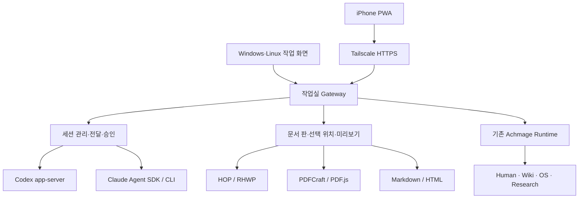

# Achmage Workbench 통합 기술 설계 v5

2026-10-16 · 제안 기준선 · 구현·배포·RAM 실측 전

이 문서는 초기 설계의 다열 기본 화면을 채택하지 않는다. PC는 단일화면-재설계-v2.md, 문서 상태와 연결은 모바일연결-공통편집상태-v3.md, 모바일 결과 확인은 모바일-즉시보기와-수정-v4.md를 종합한다.

## 1. 채택 결정

완성된 오픈소스 앱 중 가장 가까운 비교 대상은 Orca다. 실제 제품의 주 코드베이스는 **기존 Achmage·HOP·PDFCraft를 연결하는 별도 얇은 웹 작업실**을 추천한다.

- 새로 작성할 주 영역: 단일 화면 UI, 작업/세션 연결, 문서 revision 및 미리보기 전달, 모바일 재접속.
- 재사용할 핵심: Achmage work/knowledge runtime, 사용자 HOP/RHWP 패치, PDFCraft, 공식 Codex app-server, 공식 Claude Agent SDK/CLI.
- Orca: 계정 로그인·세션 이벤트·취소·재연결·usage 표시의 코드/테스트를 우선 검토하되 독립적으로 추출 가능한 작은 단위만 재사용.
- 초기 배포: 동일 React 웹 UI를 Windows/Linux 브라우저와 iPhone PWA에서 사용.
- 데스크톱 파일 연결·트레이·단축키·업데이트가 필요해지면 동일 UI를 Tauri 2로 패키징.
- Hermes, Herdr, OpenRig, cmux는 필요가 확인된 기능에만 어댑터로 연결한다.

따라서 “Orca 전체 포크로 확정” 또는 “모든 기능을 새로 개발”로 표현하면 부정확하다. 이름을 붙인다면 기존 자산을 조합하는 Achmage Workbench이며, Orca는 핵심 비교 대상과 선택적 코드 공급원이다.

빠른 대안은 Orca 웹/원격 경로를 작은 확장으로 사용하는 것이다. 다만 기존 worktree 중심 상태와 Achmage work 정본, 문서 revision, v2 단일 화면을 연결하는 수정 범위가 작다는 것을 먼저 확인해야 한다. 소규모 수정으로 요구와 RAM 기준을 만족하면 이 대안을 다시 채택할 수 있다.

## 2. 후보 비교

| 후보 | 확인한 구조 | 장점 | 이번 제품에서의 결정 |
|---|---|---|---|
| Orca | TypeScript·React·Electron, Node 서버와 웹 빌드, MIT | Claude/Codex 구조화 채팅, 원격 세션, usage/계정/재접속에 가장 가까움 | 완성형 비교 1순위, 선택 코드 재사용 후보 |
| Herdr | Rust, Apache-2.0, 터미널 실행 관리 | 터미널·프로세스 수명, 기기 연결 | PTY 방식이 꼭 필요한 제공자를 나중에 붙일 때 검토 |
| OpenRig | TypeScript/Node+tmux, Apache-2.0 | 역할·공유 맥락·지속 팀 운영 | 초기 필수 아님. 장기 다중 에이전트 팀이 필요할 때 독립 연동 |
| cmux | 주 GUI Swift/macOS, 별도 Rust TUI | 탭·알림·터미널 작업 경험 | 기본 베이스에서 제외, UX 참고. GUI와 TUI 지원 범위 별도 확인 |
| Hermes | Python, MIT, agent/gateway/dashboard | 비서·메신저·기억·비동기 작업 | 기존 유용한 업무를 수행하는 외부 작업자 |
| HOP/RHWP | 사용자 수정본 TypeScript/Vite/Tauri + Rust/WASM, manifest MIT | 사용자 한글 편집·조판 자산을 직접 재사용 | 한글 문서 엔진의 주 기반 |
| PDFCraft | Rust native engine/CLI, egui WASM web, MIT OR Apache-2.0 문서 표기 | 기존 PDF 기능과 사용자 글꼴 패치 | PDF 조작 엔진 재사용. 앱 전체 UI 임베딩은 선택 |

Orca 확인 판의 package는 1.4.214, Node 요구는 24, React 19 계열, Electron 43 계열이다. 이는 관찰한 판이며 새 앱의 모든 의존성을 그 버전으로 강제하는 결정은 아니다.

Orca Chat UI는 실험적이며 native Windows/Linux와 paired server의 구조화 세션을 지원한다고 문서에 명시된다. SSH/WSL은 별도 terminal-backed 경로다. orca serve는 Node orcad가 기본이지만 실패 시 Electron 서버 fallback이 있고 Windows service 명령은 아직 지원하지 않는다고 문서에 적혀 있다. “창이 없다=Electron이 없다”로 평가하지 않는다.

선택한 Orca Claude adapter는 많은 내부 session/account/lifecycle 모듈에 의존한다. 독립 패키지처럼 바로 떼어 올 수 있다는 가정은 하지 않는다. 로그인 URL 처리나 이벤트 분류 등의 작은 단위와 회귀 사례를 먼저 검토한다.

cmux는 루트 기준 GPL-3.0-or-later이고 특정 web/server/relay 디렉터리는 BUSL-1.1이다. 복제할 때 디렉터리별 LICENSE와 원문 고지를 확인한다. 위 표의 라이선스는 모든 서드파티 의존성·글꼴·브랜드까지 같은 권리를 보장한다는 뜻이 아니다. Obsidian은 이 작업의 오픈소스 엔진으로 선택하지 않으며 vault 파일과 편집 경험을 연결한다.

## 3. 기술 스택

| 계층 | 제안 | 선택 이유 |
|---|---|---|
| 화면 | React + TypeScript + Vite | PC/PWA 코드 공유, Orca 계열 UI 경험과 문서 모듈 연결 |
| 상태 | 작은 UI store + 서버 상태 cache, 구조화 이벤트 | 전체 앱 상태를 채팅 메시지나 URL에 몰아넣지 않음 |
| 스타일 | CSS 변수 기반 디자인 토큰, 필요한 접근성 컴포넌트 | 사용자 테마·밀도·글꼴 튜닝, 단일 화면 유지 |
| 실행 host/gateway | Node 24 + TypeScript, HTTP API + SSE 이벤트 | 공식 Claude TS SDK와 Codex stdio 연결, 웹 UI와 타입 공유 |
| 계약 | 버전 있는 JSON Schema/TypeScript 타입 | Electron/Tauri/browser 전송 경로와 기능 분리 |
| 로컬 상태 | SQLite + 문서/미리보기 파일 cache | 이벤트 cursor, request 중복 방지, revision 대응 |
| Achmage | 기존 Python runtime의 정식 인터페이스 | knowledge/work/research 시스템 재작성 방지 |
| 한글 | 기존 HOP/RHWP의 Rust/WASM + 웹 editor | 기존 조판/글꼴/선택/Undo 자산 유지 |
| PDF | PDF.js 보기 + PDFCraft 조작/렌더 | 보기와 고급 편집 비용 분리 |
| Markdown | CodeMirror 6 기반 원문 보존 편집 | Obsidian식 문법 표시·선택·링크. 임의 YAML/본문 재직렬화 회피 |
| HTML | 격리된 웹 preview + 필요 시 호스트 브라우저 렌더 | 실제 화면·인터랙션과 정적 검토 구분 |
| 모바일 | 반응형 PWA + Tailscale Serve | 하나의 화면 코드, 자체 네트워크 중계 개발 축소 |
| 데스크톱 포장 | 필요 시 Tauri 2/Rust | 파일 연결·트레이·앱 창. 동일 web UI 유지 |

새로 주로 작성하는 언어는 TypeScript다. Python과 Rust는 이미 가진 runtime/문서 엔진을 유지하는 언어다. 모든 기능을 Rust로 다시 옮기거나 Swift/Kotlin 모바일 앱부터 만드는 것은 초기 범위에 넣지 않는다.

SSE는 서버 이벤트를 받는 초기 선택이며 요청은 HTTP로 보낸다. WebSocket이 필요한 실행 인터페이스는 gateway 내부로 감춘다. provider raw protocol을 휴대폰에 그대로 노출하지 않는다. 새 서버 프레임워크나 상태 라이브러리의 세부 선택은 작은 기능 검증에서 고정하고 성능을 추정하지 않는다.

## 4. 실행 구조와 책임



초기에는 연구실 PC 한 대가 실행을 소유한다. 휴대폰과 노트북은 같은 실행에 접속한다. 이후 Linux 노트북에도 host agent를 추가할 수 있다. 다른 기기에서 보는 것과 실행을 그 기기에서 재개하는 것은 별도 동작이다.

상태는 네 식별자로 묶는다: workId, provider/host/nativeSessionId, artifactId/revision, requestId. UI는 식별자 입력을 요구하지 않는다.

Achmage가 work와 지식 정본을 소유하고, gateway는 실행 이벤트·연결·캐시를 관리한다. SQLite live DB를 Dropbox 폴더에 두어 동시 동기화하지 않는다. 확정 파일·불변 기록·재개 정보만 기존 Achmage 보관 방식으로 회수한다. 새 앱의 별도 지식 저장소를 만들지 않는다.

## 5. 로그인과 사용량

사용자가 경험하는 초기 연결은 연구실 PC에서 Codex 로그인, Claude 로그인, 휴대폰 연결의 세 단계다.

| 대상 | 경로 | 보존 경계 |
|---|---|---|
| Codex | 공식 app-server/CLI의 ChatGPT 로그인 | 공식 실행기가 호스트의 전용 프로필에서 인증 유지 |
| Claude | 수정하지 않은 공식 Claude Code 로그인과 Agent SDK/CLI | 공식 로그인 흐름 사용, 호스트 프로필에 유지 |
| 휴대폰 | Tailscale 기기 등록 + 작업실 기기 승인/세션 | 공급자 토큰을 휴대폰에 복사하지 않음 |
| 추가 실행 PC | 그 호스트의 연결 및 공급자 인증 상태 확인 | Dropbox로 인증 디렉터리를 복제하지 않음 |

기존 공식 앱의 토큰 파일을 읽어 가져오는 방식은 기본 경로로 삼지 않는다. 사용자가 기대하는 계정이 선택됐는지 표시하며 로그인 상태, 실행 가능 상태, 남은 한도는 분리한다.

Codex app-server의 rich client/managed account 경로를 사용한다. Claude의 2026-10-07 공식 도움말은 Agent SDK, claude -p, third-party apps가 계속 구독 한도를 쓸 수 있다고 안내한다. 이것이 모든 배포·대리 인증·호스팅 방식의 허용을 뜻하지는 않으므로 제품화 범위가 바뀌면 공식 조건을 다시 확인한다. 현재 제안은 본인 기기에서 쓰는 개인 작업실이다.

앱 UI는 구독 한도, 해당 세션의 token 사용, API 과금을 구분한다. 확인 가능한 공식 정보만 갱신 시각과 함께 표시하고 확인 불가를 0으로 만들지 않는다. 사용자가 새 탭의 제공자를 선택할 수 있게 하며 한도 도달 때 알리지 않고 API 과금이나 다른 제공자로 전환하지 않는다.

모델·CLI 이름은 공급자 목록에서 불러오고 제공자별 능력 차이를 유지한다. Claude 세션을 Codex 세션으로 변환했다고 표시하지 않는다. 새 세션에 목적·확정 문서·필요한 맥락을 인계한다.

## 6. 합의한 PC 화면

기본은 **한 작업, 한 주 화면, 한 입력창**이다.

- 상단: 작업/폴더 입구, 현재 작업 이름, 필요한 경우 Claude/Codex 세션 탭과 새 세션 버튼.
- 상태 한 줄: 현재 단계, 담당 제공자, 실행 기기. 세부 정보는 눌렀을 때만.
- 중앙: 대화 흐름과 결과 카드. 문서를 열면 이 면에서 편집하며 길게 작업할 때 같은 면을 넓혀 쓴다.
- 하단: 현재 대화 또는 선택한 문서 영역에 대한 입력창 하나.
- 확인 입구: 실제 사람 판단이 필요한 요청만 모음.

왼쪽 폴더는 사용자가 원하면 고정할 수 있지만 기본은 접힌 입구다. 중첩 폴더·이름·순서·최근 위치는 PC와 모바일이 동일 데이터를 사용한다. 폴더는 실제 디스크 경로와 분리한다. Kanban은 작업 선택기의 선택형 보기다.

탭 전환은 보이는 세션을 바꾸는 동작이며 실행을 중단하지 않는다. 닫기·보관과 실행 중지는 별개다. 수많은 탭을 화면에 계속 늘어놓기보다 현재/고정/최근 세션을 보여주고 나머지는 목록에서 찾게 한다.

다른 세션에 보내기는 메시지/문서의 보내기 또는 입력창 수신자 선택으로 한다. 질문, 확정 문서 판, 전달 범위, 회신 위치가 따라간다. 답은 원래 작업에 들어온다. 전달됨과 검토 완료를 혼동하지 않고, requestId로 중복 요청을 막는다. 사용자가 선택한 한 번의 검토를 자동 무한 토론으로 늘리지 않는다.

테마는 밝고 차분한 본문, 딥 네이비 선택 상태와 흰 아이콘/텍스트를 기준으로 한다. 한글 입력 중 Enter 오발송, 로그인 뒤 포커스 복귀, 터치 선택, 스크롤 점프, 초안 보존을 출시 조건으로 둔다.

## 7. 문서 편집과 모바일

문서를 고쳤다면 다음 AI 요청이 그 확정 판을 사용해야 한다. 실행 전 저장 완료와 tool-visible 내용 준비를 확인하고, 결과 적용 전 baseRevision을 대조한다. 이미 실행 중인 모델의 문맥이 소급 변경된다고 가정하지 않는다.

AI는 작업 사본/제안에 쓰고 앱이 현재 판과 비교하여 적용한다. 문서별 활성 작성 소유자는 하나, 다른 AI는 고정 판 검토가 기본이다. 사람의 수정과 겹치면 충돌 부분만 확인한다. 모든 저장마다 별도 승인을 요구하지 않는다.

HOP 통합 시 standalone HOP의 별도 AI 패널을 다시 켜서 세션을 이중 실행하지 않는다. editor는 선택/수정/Undo/저장 계약을 제공하고 workbench가 AI 요청을 맡는다. 현재 로컬 HOP bridge 문서는 단일 문단 등 제약이 있으며 최신 README의 넓은 기능 설명과 실제 지원 범위를 다시 맞춰야 한다. 이미 모든 조합이 작동한다고 보지 않는다.

모바일에 전달하는 결과는 파일 링크만이 아니다. 첫 화면/페이지 preview, 준비 상태, 원본 판, 선택 위치를 포함한다.

- HTML: PC 배치 실제 캡처와 격리된 상호작용 화면을 구분.
- PDF: 내장 뷰어로 즉시 보기, PDFCraft로 지원되는 변경 수행. 원본 저작 파일이 있으면 원본 수정 후 재출력.
- 한글: 호스트에서 렌더한 페이지 보기, 매핑 가능한 문단/표 값의 부분 편집, 복잡한 배치에 위치 연결 요청.
- Markdown: 같은 파일/문단의 직접 편집. 전체 vault를 rich text로 일괄 변환하지 않음.

화면의 선택은 artifact revision, 페이지, 영역, 텍스트, 가능한 구조 node에 묶는다. 이미지 좌표만으로 원본의 모든 위치를 확정하지 않는다. source mapping이 불확실하면 제안으로 처리한다. 새 원본이 생기면 이전 preview를 무효화하고 늦게 도착한 옛 렌더를 최신으로 게시하지 않는다.

복잡한 모바일 문서는 원래 배치와 읽기 편한 내용 보기를 제공한다. 내용 재배치가 원본 레이아웃 검증을 대신하지 않는다. 스캔 OCR, PDF 본문 변경, HWPX 개체와 글꼴 지원은 형식별로 확인한다. HWP는 읽기 입력, 최종 한글은 현재 승인된 워크플로우의 HWPX다.

## 8. 지식·워크플로우와 비용

작업 시작 때 Human의 이유·Wiki의 재개 맥락·OS의 승인된 방법·Research의 근거를 필요한 만큼 연결한다. ‘참고한 근거’에서 이름·이유·읽은 범위·판을 확인하고 제외할 수 있다. 모든 내용을 매 턴 자동 전송하지 않는다.

작업이 끝나면 코드와 배포 자산은 GitHub, 필요한 통찰은 Human, 이어갈 맥락은 Wiki, 반복 가능한 검증 절차는 OS 후보/현행 정책, 판단 근거는 Research로 회수한다. 같은 자료를 네 곳에 복제하거나 모든 작업에서 문서 네 개를 생성하지 않는다. 기존 Human 원본 메타데이터는 조회/색인의 부수 효과로 수정하지 않는다.

네 Workflow Engineering 원칙을 다음 합격 조건으로 연결한다.

| 원칙 | 제품에서의 확인 |
|---|---|
| Step Awareness | 현재 해야 할 일과 막힌 이유가 보이고 파일 전달·재설명 단계가 줄어듦 |
| Change-Aware Design | 모델·기기·문서 판이 달라져도 완료한 단계와 변경 영향 범위를 보존 |
| Human-Centered Decomposition | 사람은 목적과 실질적 판단을 맡고 반복 전달·조회·저장은 프로그램이 수행 |
| Org-Level Diffusion | 작업방식에 입력·역할·예시·완료·복구 기준이 있어 미래의 나나 다른 사람이 이어씀 |

MCP 프로토콜 자체와 모델 추론 비용을 혼동하지 않는다. 폴더·목록·저장·전달·미리보기는 GUI가 정식 서비스 API/CLI/IPC 또는 코드에서 호출하는 MCP client로 처리할 수 있다. 도구 내부 semantic retrieval처럼 실제 모델을 쓰는 처리는 별도 계측·캐시한다. 초기에는 기존 안정 인터페이스를 사용하고 UI 때문에 runtime 내부 DB를 직접 만지지 않는다.

## 9. 메모리·설치 용량 정책

현재 후보들의 동일 조건 RAM 실측은 없다. 제품 언어나 installer 크기만으로 가장 가볍다고 선언하지 않는다.

총 비용은 UI/WebView + gateway + provider CLI/SDK 자식 + 문서/WASM + preview browser + 기존 Achmage/Tailscale helper로 측정한다. 연구실에 실행을 옮겨 노트북 RAM만 낮춘 것은 전체 메모리 절감과 분리해서 보고한다.

아래는 **초기 개발 예산 제안**이지 관측값이나 보장이 아니다.

| 대상 | 제안 예산/동작 | 포함 범위 |
|---|---|---|
| 최초 웹 화면 전송 | gzip 2 MB 이하 목표 | 기본 UI. 문서 엔진/글꼴은 지연 로드하며 최초 문서 열기 비용도 따로 보고 |
| 대기 UI+gateway | 300 MB 이하 목표 | WebView 관련 프로세스 포함. provider/문서/기존 Achmage는 별도 및 전체 합산으로 보고 |
| preview disk cache | 기본 500 MB, 사용자가 조정 | 복구 가능한 미리보기만 축출. 원본·미저장 초안·현재 작업 데이터 제외 |
| 렌더 동시성 | 기본 1개 | 기존 resourceManagement에 예약하며 숨겨진 중복 렌더 방지 |
| 활성 AI | 기본 작성 1 + 필요 시 검토 1 | 사용자 작업 설정으로 조절. 보관 세션 수만큼 프로세스를 띄우지 않음 |
| 편집기 | 현재 문서 우선 | 세션 탭마다 HWP/PDF/Monaco 전체를 상주시키지 않음 |

Tauri는 Windows WebView2, Linux WebKitGTK를 사용한다. 독립 Chromium 번들을 줄일 수 있지만 WebView 메모리가 없어지는 것은 아니다. Linux 한글 IME/WASM/PDF 렌더가 미달하면 같은 UI를 브라우저/PWA로 유지한다.

설치 용량은 빌드 뒤 다음을 분리해 보고한다: 앱 자체, Node/필요 runtime, CLI 두 개, 문서/WASM, 글꼴·OCR·브라우저 assets, 개발 build cache. Tauri의 최소 shell 용량을 최종 앱 설치 용량으로 광고하지 않는다. 초기 installer MB 수치는 아직 확정하지 않는다.

공식 앱 두 개, Orca 웹/Node 서버, 새 작업실을 같은 장치·계정·세션 수·문서·상태에서 비교한다. Windows는 관련 process working set/private bytes를 함께 보고 Linux는 PSS 중심으로 비교하여 공유 메모리 중복 합산을 구분한다. idle, 한 AI 실행, 두 AI, 20쪽 문서, 장시간 대기/재연결을 각각 측정한다.

## 10. 개발 순서와 완료 조건

### 1단계 — 실제 연결과 문서 왕복

단일 화면에서 Claude와 Codex 새 세션, 공식 로그인, 스트리밍, 승인, 중지, 재개를 확인한다. 동시에 실제 HTML/PDF/HWPX 각 한 개를 iPhone에서 별도 앱·DropBox 이동·이미지 재요청 없이 확인한다. Markdown만으로 검증 완료하지 않는다.

문서 수정→확정→다른 제공자 검토→회수에 판과 위치가 따라가야 한다. 실패 사례는 사람 수정 중 AI 적용, 늦은 preview, 네트워크 재접속 중 중복 요청, 로그인 만료다.

### 2단계 — 사용자의 작업 구조

중첩 폴더, 최근/고정 탭, 내 확인, 세션 메시지 전달, Linux/연구실 host, Achmage context/기록 회수를 붙인다. 기존 공식 앱 세션은 지원되는 읽기/재개부터 연결하며 임의 live attach를 약속하지 않는다. ChatGPT/Claude 일반 웹 채팅의 모든 기록도 자동 접근을 전제하지 않는다.

### 3단계 — UI 마감과 패키징

한글 입력·포커스·터치·접근성·오프라인 초안·재접속을 검증한다. 실제 RAM과 설치 크기를 비교하고 필요한 경우 Tauri로 패키징한다. 개인 테마·templates·연결 설정은 업데이트와 분리한다. Hermes 등은 실제 반복 업무가 있을 때만 추가한다.

각 단계는 기능명 추가가 아니라 실제 사용자 흐름 통과로 끝낸다. 이번 요청에서는 설계와 코드/문서 조사만 했으며 앱 설치·제공자 로그인·개발 build·벤치마크를 수행하지 않았다.

## 11. 내부 계약과 모듈 배치

권고 배치:

```text
apps/web              단일 화면 + PWA
apps/host             Node gateway, 실행 관리, 콘텐츠 제공
apps/desktop          후속 Tauri wrapper
packages/contracts    work/session/artifact/request/event/error schema
packages/provider-*   공식 제공자 어댑터
packages/editor-*     HOP / PDF / Markdown 연결
packages/achmage      기존 runtime 인터페이스 어댑터
packages/ui           사용자 디자인 토큰과 접근성 컴포넌트
```

REST schema와 event schema는 transport와 분리한다. 목록은 cursor로 나누고 변화는 event cursor로 재개한다. mutation은 requestId와 expectedRevision을 사용한다. 같은 requestId로 내용이 다르면 거절하고, timeout은 실패로 단정하지 않고 상태 조회로 확인한다. 취소 요청과 실제 중지는 별도 상태다.

대표 기능 계약:
- Session: create/resume/send/cancel/answerApproval, capability와 provider/host identity.
- Artifact: open/commit/getPreview/select/propose/apply/revert, 원본 판과 preview 판.
- Handoff: source/target/scope/artifactRefs/replyTo/requestId.
- Knowledge: context/sourceRefs/outcome/record, 원문과 실행 권한 분리.

공통 오류는 code/message/details/requestId로 표현한다. 외부 provider·문서·브라우저 데이터는 경계에서 검증한다. revision 충돌은 별도 상태로 다루고 일반 연결 실패처럼 자동 재시도하지 않는다. 새 필드는 가능한 추가형으로 확장하며 최소 protocol version을 명시한다.

## 12. 근거와 확인 판

- R-002: research:rr-eb5dc66efa16f012e7ce30f0ab224d41:5e812d299918f1a7f756d0f23126061ec9d1c8a4ef805fbae4b9aa541b460427
- R-004: research:rr-a1b5d2271b2fa1c1e20da35300134e23:a3c4969f547d062a73912d1558f1f5996fa3889d8fd1af70e303dc0ffbe5dbf5
- R-005: research:rr-46bf61137f95d7f9ebb282ed23343ec1:b52801e6ce2afaa6b4a6851eee0b6f72cb81f3471cc7ba2f5de8deb33d758fbb
- R-006: research:rr-0dc5fe8ffad6b515a257d1f3f2bd8f31:b0e5dcf5571269817f2b194001115a955ff89aa043f63e6af217f3b78bbd2922
- R-007: research:rr-c4b5961b9256ae582e257e97ef4c3ef6:4be68deef8338e7d3c0184ee4785b2fc87b5fc612d912065fa287954eaffd430

| 저장소 | 조사 시 HEAD |
|---|---|
| stablyai/orca | `83dcc7dcb76e1da40c20cbb6e97a9fe7f0e96954` |
| herdrdev/herdr | `143bf5fd4781d164260c63fe28e7dc08054ad32f` |
| mvschwarz/openrig | `0350ed16d06c55918b207cae5cd256300e4e3c89` |
| manaflow-ai/cmux | `b09cbe7279e48ab24b0ffedc84f26073ac5651d4` |
| NousResearch/hermes-agent | `acc3cada0da86c81efc8aa6c5a291989549ca900` |
| storytold/pdfcraft | `99941daa5af17155becd2aec66d072ca0f4b8a14` |
| laguna821/pdfcraft | `48388606e669abd42a7669c21054c1a322cca7ef` |

공식 문서:
- https://www.onorca.dev/docs/agents/native-chat
- https://www.onorca.dev/docs/remote-servers
- https://github.com/stablyai/orca/blob/83dcc7dcb76e1da40c20cbb6e97a9fe7f0e96954/package.json
- https://herdr.dev/docs/windows-beta/
- https://github.com/mvschwarz/openrig
- https://github.com/manaflow-ai/cmux/blob/b09cbe7279e48ab24b0ffedc84f26073ac5651d4/LICENSE
- https://github.com/NousResearch/hermes-agent
- https://github.com/golbin/hop
- https://github.com/edwardkim/rhwp
- https://github.com/storytold/pdfcraft/blob/99941daa5af17155becd2aec66d072ca0f4b8a14/docs/architecture.md
- https://github.com/codemirror/dev
- https://learn.chatgpt.com/docs/app-server
- https://support.claude.com/en/articles/15036540-use-the-claude-agent-sdk-with-your-claude-plan
- https://v2.tauri.app/reference/webview-versions/

새 오픈소스 설치나 공급자 로그인을 수행하지 않았다. 배포 전에는 사용할 commit, package lock, renderer, 글꼴 manifest를 각 모듈에 고정하고 실제 지원 범위를 검증해야 한다.

