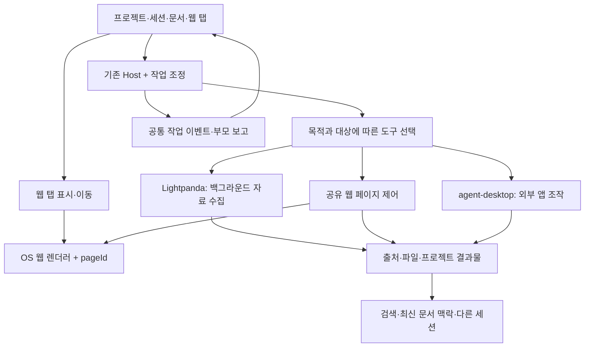

# Aside 수준의 핵심 사용성을 위한 Workbench 설계

상태: **설계 제안, 제품 구현 전**. 기준 소스: Workbench `bc1057c2c5fb04f2046f4fd711bf718f5cc93737` / 0.3.3. 이번 조사의 범위는 설치·수집·소스 검토·설계이며, 아래 기능이 이미 빌드됐다는 뜻이 아니다.

연구 근거: [이번 연구 revision 2807fc5a0c54…](07-provenance.md#이번-연구). 이전 비교 연구의 정확한 revision도 같은 문서에 보존했다.

## 목표와 설계 판단

목표는 사용자가 요청한 흐름이다. **프로젝트에서 문서·세션·웹을 함께 열고, 각 탭의 AI에게 별도 작업을 맡기며, 메인 세션은 막히지 않고 결과와 맥락을 이어받는다.** 웹은 평소에는 Lightpanda로 조용히 조사하고, 사람이 보거나 로그인해서 작업하는 경우에는 실제 웹 탭을 AI와 공유한다.

기존 앱의 프로젝트·문서 편집·이음오피스 연결·검색·알림·워크트리를 유지하면서 다음을 추가한다.

1. 주소창과 이동 기능을 갖춘 실제 웹 탭.
2. 해당 페이지를 대상으로 하는 독립 AI 작업과 오른쪽 대화.
3. 같은 작업의 진행 상황·결과를 보여주는 메인 세션 연결.
4. 사람에게 제어를 넘기고 다시 이어받는 상태 관리.
5. 필요할 때 외부 앱을 조작하는 선택적 agent-desktop 연결.

Lightpanda와 agent-desktop만 결합하면 1~4가 자동으로 생기지는 않는다. Lightpanda는 시각 렌더러가 아니며 agent-desktop은 이미 실행 중인 앱을 조작하는 도구다. [Lightpanda 구조](https://lightpanda.io/docs/core-concepts/architecture-overview), [agent-desktop 조사](03-agent-desktop.md)

## 사용자가 보는 화면

아래는 자체 설계 와이어프레임이다. Aside 화면의 복제나 현재 구현 스크린샷이 아니다.

```text
┌ 프로젝트 탐색 ┬─────────────────────────────────────────────────────┐
│ 연구 프로젝트 │ [메인 대화] [보고서.hwpx] [논문 사이트 ●] [+ 새로 만들기] │
│ [개요 · 속성] │ ← → 새로고침   https://…     [AI에게 요청] [분할] [⋯]   │
│               ├───────────────────────────┬─────────────────────────┤
│ 대화          │                           │ 이 페이지의 AI           │
│  · Codex      │ 실제 웹 페이지            │ [페이지 제목 · 도메인 ×]  │
│  · Claude     │                           │                         │
│ 문서          │ 사람이 보고 클릭할 수 있음│ 자료 찾는 중…            │
│  · 보고서     │ AI도 같은 페이지를 조작   │ [내가 조작] [일시정지]    │
│ 웹            │                           │                         │
│  · 논문 사이트│                           │ 요청 입력                │
│ AI 작업 탭    │                           │ 모델 · 첨부 · 보내기     │
│  · 학회 조사 ●│                           │                         │
└───────────────┴───────────────────────────┴─────────────────────────┘
```

메인 대화 탭에서는 프로젝트 사이드바와 메인 입력창을 표시한다. 문서 편집기는 기존 요청대로 편집 영역을 크게 보여주고 그 문서의 AI만 붙인다. 웹 탭도 전역 하단 채팅창을 겹쳐 놓지 않는다. 분할을 선택했을 때만 메인 대화와 웹을 나란히 배치한다.

### 클릭 경로와 메뉴

| 위치 | 제안 메뉴·동작 | 해결할 문제 |
|---|---|---|
| 프로젝트 이름 | 즉시 개요·YAML 속성 열기; 별도 펼침 화살표 | 프로젝트를 폴더나 개수 표시와 혼동하지 않음 |
| 공통 `+ 새로 만들기` | 새 세션, 기존 지원 형식의 새 문서, 새 폴더, **새 웹 탭** | AI 요청 없이 수작업을 시작 |
| 프로젝트 목록의 빈 공간/우클릭 | 같은 생성 메뉴와 세션 추가 | 메뉴가 숨은 상태로 남지 않음 |
| 웹 도구 모음 | 뒤로/앞으로/새로고침·중지/주소/AI/분할/다운로드 | 일반 브라우저처럼 사용 |
| 웹 탭 우클릭 | 이름 변경, 고정, 옆 칸으로 이동, 새 탭에서 복제, 닫기 | 탭 관리가 문서와 일관됨 |
| AI 작업 탭 | 진행 상태, 열어 보기, 사용자 인계, 계속, 중지 | AI가 지금 쓰는 페이지를 발견 가능 |
| 메인 대화의 작업 카드 | 진행 요약, 페이지 열기, 자식 대화 열기, 결과물 | 메인과 사이드 대화가 같은 작업을 가리킴 |
| 설정 → 웹 | 기본 조사 방식, 웹 프로필, 다운로드 위치, 사이트 권한 | 개발 도구 이름보다 사용 목적 중심 |
| 설정 → 외부 앱 | agent-desktop 설치/버전/가능 기능/권한 상태 | 실행 환경에 맞는 기능만 노출 |

새 UI 용어는 제안이다. 기존 “새 문서” 메뉴를 복제해 두 번째 생성 체계를 만들지 않고 같은 action을 재사용한다. 웹 주소를 파일 폴더처럼 취급해 “상위 폴더”를 추측하지 않는다. 볼트/파일 탐색의 상위 폴더 버튼과 웹의 방문 기록 이동을 구별한다.

## 구성



Playwright는 지원되는 렌더러를 제어하는 드라이버 후보다. 이를 일부 경로에서 사용해도 일반 자료 수집의 기본 엔진을 Lightpanda로 유지할 수 있다.

## 현재 코드와 재사용 범위

아래는 기준 commit의 관찰이다. 파일이 있다는 사실과 요구 사용성이 실제 통과했다는 사실을 구별한다.

| 현재 코드 | 관찰 | 도입할 변경 |
|---|---|---|
| [browse.ts](../../../apps/host/src/browse.ts) | Lightpanda/Chromium 선택, 로그인 창·중지·상태 관리. 기본 LP, 전역 엔진 선택 구조 | 기존 API 호환을 유지하며 작업별 실행기 선택 추가 |
| [browse-lightpanda.ts](../../../apps/host/src/browse-lightpanda.ts) | 세션별 MCP 프로세스와 Lightpanda 연결 | 배경 조사 경로 재사용; 웹 탭 표시와 분리 |
| [BrowserPill.tsx](../../../apps/web/src/components/BrowserPill.tsx) | 엔진 설치/선택, 로그인, 창 표시 제어 | 상태 UI 재사용 가능. 일반 웹 탭 자체는 아님 |
| [tabs.ts](../../../apps/web/src/tabs.ts), [panes.ts](../../../apps/web/src/panes.ts) | 탭 식별, 분할, 이동, 비활성 탭 상태 유지 | `browser` View와 `web:pageId` identity 추가 |
| [Panes.tsx](../../../apps/web/src/components/Panes.tsx) | 비활성 패널을 hidden 처리해 유지 | 네이티브 WebView의 hide/bounds/focus는 별도 연동 |
| [document-session.ts](../../../apps/web/src/document-session.ts) | 문서 viewId·heartbeat·쓰기 권한 유지 | 탭 가시성과 실행 수명을 분리하는 원칙 재사용 |
| [office-sessions.ts](../../../apps/host/src/office-sessions.ts) | 독립 실행·중복 방지·scope 검사·부모 세션 보고 | 공통 패턴 재사용; 웹을 가짜 Office 문서로 등록하지 않음 |
| [office_browser.rs](../../../apps/desktop/src-tauri/src/office_browser.rs) | 숨겨진 임시 HTML 변환 창, 제한 URL, 팝업 거부 | OS 구현 참고만; 범용 웹용 별도 격리 경로 필요 |
| [completion-notifications.ts](../../../apps/web/src/completion-notifications.ts) | 완료 알림 경로 | 웹/외부 앱 자식 작업도 같은 알림 정책 사용 |
| [worktree-workspaces.ts](../../../apps/host/src/worktree-workspaces.ts) | 프로젝트 아래 작업공간·worktree 관리 | 웹 결과물의 실제 저장 workspace를 명시 |

현재 `openLogin`은 LP에서 직접 로그인을 거부하고 Chromium 프로필로 넘어가며, Chromium 로그인 모드는 기존 에이전트와 프로필 사용을 조정한다. **이를 켜는 것만으로 같은 앱 탭에서 사람과 AI가 동시에 이어 쓰는 구조가 되지 않는다.** 현재 View 종류에도 범용 웹 페이지가 없다. 웹 탭과 세션 연결은 별도 추가 범위다.

## 렌더러 선택

| 후보 | 장점 | 확인할 비용·제한 | 판단 |
|---|---|---|---|
| Windows WebView2 | 기존 Tauri 환경과 맞음; CDP 연결 공식 문서 존재 | 프로필, 팝업, 다운로드, target 식별, 앱 UI와 격리 확인 | 첫 실증의 우선 후보 |
| macOS WKWebView / Linux WebKitGTK | OS WebView 재사용, 별도 Chromium 번들 부담 감소 | WebView2와 동일한 CDP 방식으로 제어할 수 없음; 플랫폼별 driver 필요 | 수동 탐색과 AI 제어를 각각 검증 |
| Chromium/CEF 공통 렌더러 | 플랫폼 간 제어 API 통일 가능 | 별도 런타임 배포·용량·업데이트·Tauri 내장 작업 증가 | OS WebView 실증 실패 시 비교할 대안 |
| 외부 Chromium 창 | 현재 구조에서 접근하기 쉬움 | 앱 내부 웹 탭 경험과 다름 | 호환 경로로 유지 가능, 핵심 완료로 계산하지 않음 |

공식 근거: [Tauri의 OS별 엔진](https://v2.tauri.app/reference/webview-versions/), [WebView API](https://v2.tauri.app/reference/javascript/api/namespacewebview/), [Playwright의 WebView2 CDP 연결](https://playwright.dev/docs/webview2). 이 자료들은 **우리 앱의 모든 OS에서 동작함을 증명하지 않는다.** Playwright의 WebKit 지원을 임의의 WKWebView/WebKitGTK 연결 가능성과 동일시하지 않는다.

권장 순서는 Windows WebView2에서 “사람이 로그인한 같은 페이지를 AI가 읽고 조작 → 탭 전환 → 재개”를 먼저 실증하는 것이다. 동시에 macOS/Linux는 같은 인터페이스의 가능한 기능을 확인한다. 결과에 따라 플랫폼별 지원 범위를 명시하거나 공통 렌더러 대안으로 전환한다. 설치 크기 증감은 실제 패키지로 측정하며, 현재 자료만으로 MB 수치를 약속하지 않는다.

실증에는 네이티브 child WebView와 React 패널의 겹침·크기 변경·분할·포커스·한글 IME도 포함한다. 단순히 URL이 뜨는 것만으로 제품에 내장 가능한 렌더러라고 결론 내리지 않는다.

## 작업과 페이지의 식별

다음 이름은 **제안 데이터 모델**이다. 기존 ID와 중복되는 모델을 새로 만들기보다 계약을 확장한다.

| 필드 | 역할 |
|---|---|
| `workId`, `workspaceId` | 프로젝트 맥락과 실제 파일 저장 worktree |
| `profileId` | 웹 로그인·쿠키·저장소 경계 |
| `pageId` | 살아 있는 웹 페이지의 식별자; URL과 별개 |
| `viewId` | 페이지를 보여주는 UI 위치. 이동/숨김 때문에 pageId가 바뀌지 않음 |
| `taskId`, `agentSessionId` | 실행과 독립 자식 대화 |
| `parentSessionId` | 진행·결과를 받는 메인 대화 |
| `boundPageIds` | 여러 사이트를 쓰는 한 작업의 페이지 목록 |
| `navigationRevision` | 현재 문서가 바뀌었는지 판단하는 번호 |
| `controlOwner` | 사용자/작업/인계 중/없음 |

같은 URL 두 개를 열면 다른 pageId다. 탭을 옆 칸으로 이동하면 같은 pageId를 유지한다. “복제”는 새 pageId를 만든다. 하나의 네이티브 페이지를 두 패널에 동시에 표시한다고 가정하지 않고, 기존 뷰 이동 또는 명시적 복제로 처리한다.

사이드 AI와 메인 세션의 카드가 가리키는 taskId는 같다. UI마다 작업을 재시작하지 않는다. 각 사이드 AI는 별도 agentSessionId를 가지며, 부모의 실행 잠금이나 입력 대기열을 공유하지 않는다.

## 탭 이동과 작업 수명

작업은 host가 소유한다. React 컴포넌트 표시 여부에 실행 권한과 프로세스 수명을 매달지 않는다.

| 이벤트 | 제안 동작 |
|---|---|
| 다른 탭 선택, 패널 숨김, 분할 이동 | 작업과 페이지 유지; 표시 위치만 변경 |
| 사람이 AI 탭을 열어 보기 | 상태를 확인할 수 있음; 관찰만으로 작업 취소하지 않음 |
| 사람이 입력/클릭하려 함 또는 `내가 조작` 선택 | 다음 AI 변경 행동을 막고 진행 중 행동 경계를 확인한 뒤 제어 인계 |
| `AI 계속` 선택 | 현재 URL·DOM·navigationRevision을 다시 읽고 이어서 수행 |
| 작업 중인 탭 닫기 | 기본은 UI에서 숨겨 AI 작업 목록에 유지; `작업 중지하고 닫기`는 명시적 별도 동작 |
| 작업 중지 | 소유한 자식 작업과 페이지 동작까지 중지하고 한 번만 종료 이벤트 |
| 앱 종료/크래시 후 재시작 | 기록은 복원, 휘발성 DOM 실행은 interrupted로 표시; 확인 후 재개 |

공유 페이지에서는 읽기 관찰을 병행할 수 있지만 변경 행동은 pageId별 한 소유자만 수행한다. 페이지가 다르면 병렬 실행할 수 있다. 물리 마우스/키보드를 쓰는 외부 앱 작업에는 기기 수준의 추가 조정이 필요하다. **여러 세션을 열었다는 이유만으로 같은 데스크톱이 격리되지는 않는다.**

## Lightpanda와 공유 웹 탭의 배분

| 요청·상태 | 기본 경로 | 사용자에게 보이는 방식 |
|---|---|---|
| 공개 자료 검색·여러 링크 추출 | Lightpanda | 진행과 출처·결과만 표시, 필요할 때 링크 열기 |
| `이 페이지에서 해줘` | 현재 공유 웹 pageId | 같은 탭에서 진행, 오른쪽 대화 |
| 로그인된 사이트·입력 중인 양식 | 해당 프로필의 공유 웹 페이지 | 로그인/입력 상태를 유지 |
| LP에서 사이트 기능 호환 문제 | 호환 렌더러에서 새 페이지를 여는 경로 제안 | 전환 사실과 새 페이지임을 표시 |
| 외부 데스크톱 앱 UI 작업 | 지원 확인된 agent-desktop | 대상 앱과 작업 상태 표시 |

숨긴 공유 웹 탭을 자동으로 Lightpanda로 바꾸지 않는다. 화면에서 안 보인다는 사실은 엔진을 교체할 근거가 아니다. URL·추출 결과를 새 페이지에 전달할 수 있어도 JavaScript 메모리·입력 중인 폼·로그인 세션을 통째로 옮겼다고 가정하지 않는다. LP와 WebView 간 쿠키 복사도 기본 동작으로 삼지 않는다.

현재 전역 `setEngine`을 실행 중 작업마다 바꾸는 방식은 피한다. 작업을 만들 때 executor를 정하고, 필요한 전환은 별도의 page/task 전이로 기록한다. 이 변경은 기존 LP 경로를 지우는 것이 아니라 동시에 사용할 수 있는 host 조정 기능을 추가하는 것이다.

## 부모 세션·문서·검색과 연결

- 자식은 `started/progress/waiting/completed/failed/cancelled`를 공통 이벤트로 보고한다. 부모 UI는 진행 카드를 보여주며 자체 입력·작업을 계속할 수 있다.
- 부모 모델에는 다음 처리 시 필요한 요약·출처·결과물 참조를 제공한다. UI 이벤트를 억지 사용자 프롬프트로 넣거나 부모의 실행 중인 요청을 덮어쓰지 않는다.
- 프로젝트의 다른 세션은 결과물을 찾을 수 있어야 한다. 다만 다른 git worktree의 파일 경로를 같은 파일로 취급하지 않는다. 결과에 workspace·실제 경로·버전을 남긴다.
- 웹에서 받은 파일은 기존 artifact 등록 경로로 연결한다. 편집기에서 열고, “앱으로 열기”로 이음오피스에 전달하고, 저장 후 최신 파일을 다시 읽는 기존 흐름을 사용한다.
- Ctrl+K에는 사용자가 입력한 **원문 프롬프트**, 답변, 페이지 제목·URL·출처·결과물 참조를 기존 검색 문서 규칙에 맞춰 반영한다. 토큰 단위 스트림을 완성된 검색 본문으로 오인하지 않는다.
- 완료·실패·입력 필요 알림은 기존 정책을 재사용하고, 클릭하면 해당 작업/탭으로 이동한다. 동일한 종료 이벤트로 메인과 사이드에서 중복 알림을 만들지 않는다.

## 웹 페이지와 앱 권한의 경계

일반 웹은 Workbench 로컬 UI와 별도의 권한 없는 WebView에서 연다. 기존 문서 변환 WebView의 URL 제한을 제거하는 식으로 구현하지 않는다. 페이지가 가진 스크립트에 Tauri 파일·셸 명령이나 host 인증 정보를 노출하지 않고, 제어는 host가 허용한 pageId와 작업을 통해 수행한다.

CDP를 사용하는 경우 대상 WebView를 명확히 매핑하고, 로컬 연결 범위·포트 수명·프로필 경계를 관리한다. 페이지 안의 텍스트는 조사 자료이며 시스템 지시나 다른 프로젝트 접근 권한이 아니다. 이는 공유 웹 탭을 앱에 넣을 때 필요한 제품 경계다.

## 전체 Aside 기능과 첫 도입 범위

| 범위 | 처리 |
|---|---|
| 일반 웹 탭·사이드 AI·Agent Tabs·메인 진행·탭 전환 후 계속 | 핵심 완료 기준 |
| 기존 문서/이음오피스/프로젝트/세션/워크트리/검색/알림 | 유지하면서 웹 작업 연결, 회귀 검증 |
| agent-desktop 외부 앱 조작 | 분리된 확장 단계, 지원 OS/앱 명시 |
| 브라우저 전용 암호 관리자·프로필 동기화·확장 스토어 | 별도 제품 범위; 현재 웹 프로필 로그인 보존과 구별 |
| 기억 자동화·Routines·멀티 채널·클라우드 실행 | 기존 기능과 차이 조사 후 별도 계획; 핵심 완료를 계속 미루는 조건으로 추가하지 않음 |

이 구분은 미구현 기능을 숨기기 위한 것이 아니다. **사용자가 설명한 핵심 사용성의 완료와 Aside 전체 제품의 완전한 기능 동등성은 따로 표시**한다. 실행 순서와 통과 조건은 [도입 계획](05-delivery-plan.md)에서 고정한다.
