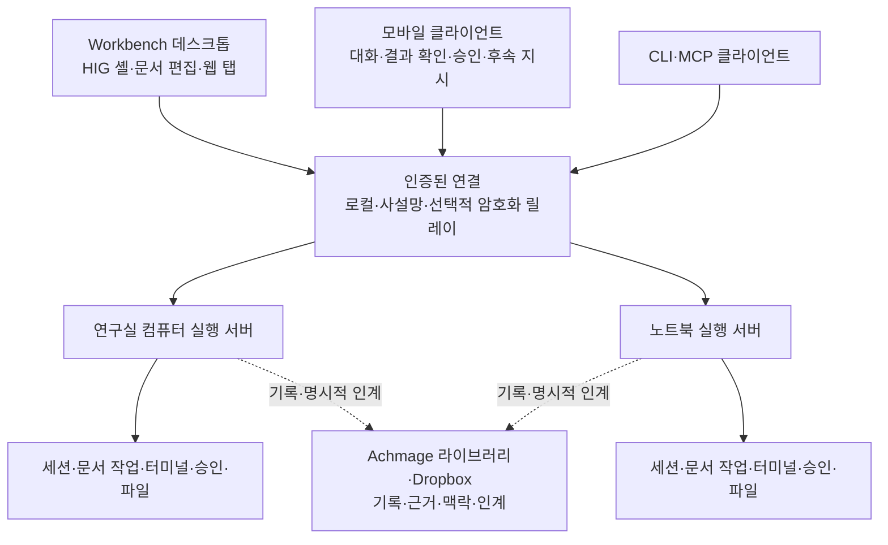

# Workbench에 Paseo의 실행·연결 구조를 통합하는 방법

이 문서는 설계 제안이다. 아래 타입·서비스·화면은 새로 구현할 대상이며 현재 제품에 있다고 읽지 않는다.

근거 연구: `research:rr-b3a4efd5af5ac21ca608ac4ce17dd71d:89fcdaee6e62df01c31f9f4c56c19d9916acab297f64b1b42cd5b67317e03ad5`. [출처·검증 범위](06-evidence.md).

## 기존 실행 서버를 독립시키는 방식을 기본으로 삼는다

Workbench는 이미 React, Tauri, Node 실행 서버, 공급자 어댑터, 문서 AI, 검색과 프로젝트 데이터를 갖고 있다. 이 서버의 수명을 데스크톱 창과 분리하고, 인증된 여러 클라이언트가 같은 작업을 관찰·제어하도록 확장하는 방식을 권고한다.

| 선택지 | 얻는 것 | 추가 작업·손실 | 판단 |
|---|---|---|---|
| Paseo 전체 앱을 포크해 Workbench 기능을 이식 | 기존 모바일·daemon·개발 UI를 넓게 재사용 | Electron·Expo 구조로 제품 중심이 이동. 이음오피스·프로젝트 YAML·검색·Tauri 연동을 다시 붙여야 함 | 현재 제품의 기본 경로로 선택하지 않음 |
| Paseo daemon을 별도 호스트로 연결 | 공식 SDK와 공급자·원격 작업 기능을 선택적으로 사용 | Paseo 세션과 Workbench 문서 세션의 소유자가 다름. 공식 모바일 앱이 우리 문서 작업까지 자동으로 이해하지는 않음 | 호환 기능의 후보 |
| 기존 Workbench 서버 확장 + 필요한 Paseo 모듈·동작 이식 | 문서·프로젝트·검색을 유지하며 실행 수명과 원격 접근을 개선 | 모바일 클라이언트와 기기 인증·복구 계약을 구현해야 함 | 기본 권고 |
| Workbench에 Paseo 프로토콜 호환 어댑터 추가 | 공식 모바일 클라이언트 재사용 가능성을 시험 | 이벤트·권한·파일·버전 계약을 충분히 맞춰야 함. 일부 RPC가 된다고 전체 호환은 아님 | 작은 호환성 실험 후 채택 여부 판단 |

`@getpaseo/client`는 `protocol`, `relay`, `ws`, `zod`에 의존한다. `internal/*` export는 구현 세부와 결합되므로 공용 SDK 진입점을 우선한다. React Native 화면이나 Electron 브라우저 코드는 Tauri React 컴포넌트에 그대로 붙는 코드가 아니다. [SDK 패키지](https://github.com/getpaseo/paseo/blob/1fff127f45b11c1c9c573fbbd12791673004c912/packages/client/package.json), [데스크톱 패키지](https://github.com/getpaseo/paseo/blob/1fff127f45b11c1c9c573fbbd12791673004c912/packages/desktop/package.json).

## 화면·실행·기록의 책임을 나눈다

실행 중인 프로세스와 작업 디렉터리는 해당 컴퓨터에 남는다. 휴대폰은 그 작업을 제어한다. Dropbox의 보관 기록은 다른 컴퓨터의 살아 있는 프로세스와 동일하지 않다. 기기가 꺼졌을 때 다른 컴퓨터가 이어받는 기능은 체크포인트·파일 상태·미완료 외부 동작을 확인하는 별도 인계다.

## 기존 프로젝트 위에 기기 연결 정보를 붙인다

| 제안 데이터 | 책임 | 보존할 기존 의미 |
|---|---|---|
| `Host` | 기기 ID, 연결 경로, 접속·절전·복구 상태, 지원 기능·버전 | 컴퓨터마다 다른 실제 경로와 실행 환경 |
| `ProjectHostBinding` | 논리 프로젝트를 호스트의 디렉터리·저장소와 연결 | 기존 프로젝트 ID, YAML, 노트·Bases 관계 |
| `Workspace` | 현재 디렉터리 또는 격리 worktree, 서비스·터미널의 소속 | 모든 문서 작업에 Git을 강제하지 않음 |
| `AgentRun` | 세션·실행 ID, 호스트, 공급자, 부모 관계, 현재 턴·상태 | 독립 문서 AI와 메인 채팅의 동시 실행 |
| `AgentChild` | Workbench가 만든 자식인지 공급자 내부 자식인지, 가능한 제어 | 읽기 전용 하위 기록을 제어 가능한 세션으로 오표시하지 않음 |
| `Artifact` | 파일·이미지·문서 참조, 버전, 원본 호스트, 썸네일·출처 | 원문 프롬프트와 메시지 ID, 문서 revision |
| `ApprovalRequest` | 승인 대상 동작·작업·버전, 응답 ID, 만료 | 같은 요청에 두 기기가 중복 승인하지 않음 |
| `EventCursor`·`CommandReceipt` | 호스트 실행 세대·이벤트 순번, 명령 접수·실행 결과 | 세대가 바뀌면 snapshot 재동기화. 결과 불명 요청을 조회·조정하고 무조건 재실행하지 않음 |

식별자들은 현재 `packages/contracts`와 호스트 저장 구조에 추가하는 후보다. 파일 구조와 공급자별 capability를 먼저 대조하고 최소 변경으로 넣는다. 프로젝트·대화 전체를 새 DB로 이사하는 작업은 선행 조건으로 두지 않는다.

## 문서 작업을 화면의 생존 여부와 분리한다

현재 문서 AI는 문서의 live 연결·쓰기 권한을 검사한다. 탭을 숨긴 채 유지하는 방식은 탭 전환을 지원하지만 데스크톱 종료나 휴대폰 연결 끊김까지 해결하지 않는다. 정확한 소스 경계는 [현행 차이](03-workbench-gap.md)에 있다.

제안은 다음과 같다.

1. 실행기가 서버에서 동작하는지, UI·iframe이 제공해야 하는 단계가 있는지부터 구분한다. 필요한 실행기가 없는 상태에서는 UI 없는 문서 실행을 지원한다고 표시하지 않는다.
2. 시작할 때 실행 서버가 작업 ID, 문서 경로·revision, 입력 snapshot, 쓰기 범위와 권한을 저장한다. 미저장 편집 내용과 디스크 파일을 구분하고 물리 파일의 writer 인계를 확인한다.
3. UI의 접속 상태는 누가 현재 문서를 보고 있는지 나타낸다. 승인된 작업의 생존 근거와 분리한다.
4. AI 수정은 서버가 기록한 revision에 대한 변경안으로 취급한다. 사용자의 외부 이음오피스 저장이나 다른 편집기가 만든 변경은 새 revision으로 관찰한다.
5. 내용이 충돌하면 작업을 입력 대기 상태로 바꾸고 결과물을 보존한다. 다른 화면으로 이동했다는 이유만으로 실행 권한을 잃게 하지 않는다.
6. 메인 채팅에는 자식 작업의 상태·결과 참조를 보고한다. 중복 보고는 ID로 제거하고, 메인 채팅의 새 요청은 계속 받을 수 있게 한다.

UI 연결이 필요한 기능은 capability로 표시한다. 예를 들어 보이는 웹 페이지 조작은 해당 브라우저 호스트가 필요할 수 있다. 단순 파일 작업과 headless Lightpanda 작업은 실행 서버만으로 수행하는 경로를 별도로 둔다. Lightpanda 경로는 이번 Paseo 조사에서 새로 검증한 기능이 아니라 [선행 Aside 설계](../aside-agent-desktop-2026-11-04/README.md)의 의존 항목이다.

## 종료·재시작을 사용자가 구분할 수 있게 한다

| 사용자 행동 | 설계할 동작 |
|---|---|
| 창 닫기 | 기존 트레이 동작 유지. 실행 중인 작업 수 표시 |
| 앱 UI 종료, 작업 유지 | 독립 실행 서버는 유지. 휴대폰과 다음 데스크톱 실행이 재접속 |
| 작업 완료 후 종료 | 이미 승인된 작업을 마친 뒤 관리 중인 실행 서버만 정상 종료 |
| 모든 작업 중지 | 중지 대상·저장 상태를 보여주고 요청별 결과를 기록 |
| daemon 재시작·업데이트 | 재접속 가능한 작업과 중단된 작업을 구분. 중단된 에이전트의 재프롬프트는 명시된 복구 정책에 따름 |
| OS 절전·전원 꺼짐 | 해당 호스트가 실행할 수 없음을 표시. 다른 호스트로 자동 이전됐다고 표시하지 않음 |

일반 설치에서 Windows·macOS·Linux의 로그인 후 실행을 제공하려면 각 OS에 맞는 서비스·시작 등록과 제거·업그레이드 검증이 필요하다. Paseo의 NixOS·Docker 사례가 우리 Windows 설치 흐름까지 검증해 주지는 않는다.

## 기기 연결과 알림을 사용자 기능으로 완성한다

초기 연결 화면은 호스트 이름, QR 또는 연결 코드, 승인할 기기, 마지막 접속, 연결 해제를 보여준다. 단순히 서버 주소를 공개하는 옵션으로 끝내지 않는다. 기기를 지웠다는 UI와 서버에서 그 기기의 권한을 철회했다는 결과를 구분한다.

모바일에서 읽기, 메시지 전송, 승인, 중단, 터미널 조작은 권한을 구분한다. 구현체는 검토된 전송·암호화 라이브러리를 사용하고 자체 암호 규약을 만들지 않는다. 첫 실증은 사설망 또는 VPN에서 **한 실행 호스트에 데스크톱과 휴대폰을 함께 연결**하는 것으로 시작한다. 이를 통과한 뒤 두 호스트와 외부망 연결·재접속으로 넓힌다.

알림은 기본적으로 기기·프로젝트·작업 상태를 알려준다. 답변 본문이나 승인 상세를 잠금 화면에 내보내는 설정은 별도로 둔다. Paseo의 push 경로는 relay 암호화와 별개이므로, 릴레이만 도입했다고 알림 본문까지 같은 보호를 받는다고 판단하지 않는다.

Wi-Fi에서 셀룰러로 바꾸거나 앱이 백그라운드로 갔다 돌아오면 마지막 cursor부터 상태를 맞춘다. 호스트 실행 세대가 달라졌으면 오래된 순번을 그대로 적용하지 않고 snapshot을 다시 받는다. 보내기 버튼을 두 번 누르거나 응답을 못 받은 요청을 재전송해도 동일 명령의 접수·실행이 중복되지 않도록 durable receipt로 조정한다. crash 직전 외부 동작의 결과를 입증할 수 없는 경우에는 `outcome_unknown`을 보존하고 조회·사용자 확인을 거친다. 이를 모든 외부 동작의 무조건적인 exactly-once 보장으로 표현하지 않는다. 전송 대기와 서버 실행 중을 구분해서 표시한다.

## 코드 재사용을 작은 경계로 제한한다

| 재사용 후보 | 방식 |
|---|---|
| 스트림 묶기·변경 없는 행 캐시·읽기 위치 계산 | 순수 로직과 테스트를 우선 검토. 현재 Transcript 계약에 맞춰 이식 |
| 메시지·도구·첨부·하위 작업의 정규화 | 공급자 capability를 보존하는 공통 모델로 적용 |
| 연결 상태·재접속·cursor·호스트 식별 | 전송 계약을 참고하고 공식 SDK 호환성 실험으로 검증 |
| 모바일 화면 구성·첨부 확대 보기·적응형 패널 | RN 의존 경계를 확인한 뒤 컴포넌트 또는 동작 단위로 선택 |
| daemon 전체·Electron 셸·공개 relay 서비스 | 기본 번들로 자동 포함하지 않음. 별도 호환·운영 결정 필요 |
| 플러그인·음성 모델·Hub | 핵심 기능 이후 선택 모듈. 설치 크기·권한·한국어 품질을 따로 확인 |

Paseo 원본은 Apache-2.0이고 제3자 구성요소에는 각각의 라이선스가 적용된다. 코드 이식 시 원본 SHA, 저작권·라이선스·해당 NOTICE와 수정 내역을 보존한다. 제품 이름과 로고를 가져오는 범위로 해석하지 않는다. [원본 LICENSE](https://github.com/getpaseo/paseo/blob/1fff127f45b11c1c9c573fbbd12791673004c912/LICENSE).
